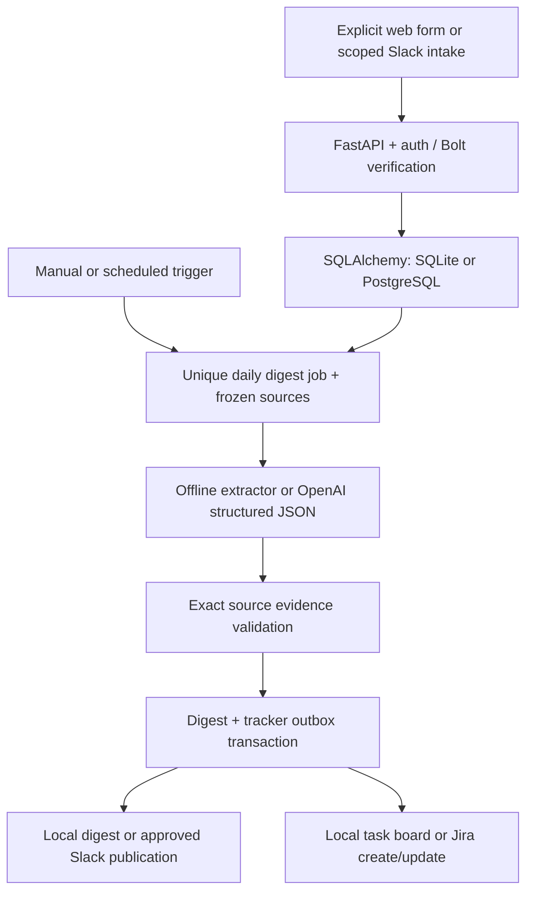

# PulseDesk — The Status-Update Tax

A complete **FastAPI hackathon product** for short async team updates, a faithful
source-backed daily digest, and actionable tracker tasks. The responsive UI is
served by FastAPI; no separate frontend server, Node build, or external assets
are required to run it.

## Start the product

Python 3.11+ is required. Extract this package and open a terminal in its folder:

```bash
python -m venv .venv
# Linux/macOS:
. .venv/bin/activate
# Windows PowerShell instead: .venv\Scripts\Activate.ps1
pip install -r requirements.lock
python run.py
```

Open **http://127.0.0.1:8000**. Default demo login:

- Username: `admin`
- Password: `demo-pulsedesk`

The launcher creates the data folder and runs Alembic migrations before starting
FastAPI. No external credentials are needed in demo mode. Copy `.env.example` to
`.env` when you want to customize the team, schedule, or live adapters. Start with
a **new** database: this product’s schema is not an in-place migration for the
legacy PulseDesk/PLUSDESK SQLite database or the earlier Step 1–2 package.

## What changed

| Capability | Earlier foundation | This product |
| --- | --- | --- |
| Async collection | Verified Slack intake | Slack intake plus an authenticated, consent-based web form |
| UI | No integrated dashboard | Responsive premium dashboard, searchable updates, digest, evidence drawer, task board, privacy/integration view |
| Daily digest | Data model/design | Durable extraction, frozen evidence snapshot, manual and scheduled triggers, export, delivery state |
| Evidence | Saved source IDs/URLs | Structured claims with locally checked quotes/IDs and trusted source links |
| Repeat tracking | No durable report history per task | One task shows distinct report/repeat counts and a source-by-source occurrence log |
| Deadlines | No task due-date workflow | Explicit user-set, editable/clearable deadline with due-state display and queued Jira sync |
| Tracker | Outbox schema/design | Working local demo tracker and implemented Jira Cloud create/update adapter |
| LLM | Architecture only | Deterministic labelled offline demo and OpenAI strict structured-output adapter |
| Scheduler | Architecture only | Database-backed worker with leases, bounded retry attempts and daily uniqueness |
| Access | Webhook verification | Sign-in, signed HttpOnly cookies, CSRF validation, scoped dashboard reads |
| Deployment | Basic Docker foundation | Single-command local launcher, API/worker/migration Compose services, custom-domain reverse proxy |
| Presentation | Technical documentation | A three-minute demo script, live setup guide, feature map and validation notes |

Your original archive was not overwritten. This package is a replacement product
codebase built from the earlier modular backend foundation. No unrelated legacy
frontend/database files or bundled virtual environments are included.

## The product flow

1. Share **Completed**, **Next**, and **Blockers** through the web form or `/standup`.
2. Generate a digest, or let the scheduled worker trigger it at the configured time.
3. The worker freezes sources, extracts structured Progress/Blockers/Action Items,
   and verifies every evidence ID and exact quote against the original update.
4. The renderer attaches stored source URLs/IDs. Open a source drawer to inspect
   the original wording; export the digest with its source references.
5. Blockers and explicit next steps create durable task records. Demo mode saves
   local tasks; live mode creates/updates Jira issues with source evidence.
6. Repeated exact findings reuse one logical task. Every distinct source report is
   recorded once; the task shows total reports and repeat count. User-set deadlines
   stay on the task and are not inferred by the extractor.
7. Repeated triggers reuse one team/day snapshot. Unknown external create/post
   outcomes are held for review instead of blindly producing duplicates.

The UI shows **Local demo** clearly. Offline extraction is literal and conservative,
not an LLM simulation. Demo task IDs are `DEMO-*`, not fake Jira claims. Live mode
has no silent demo fallback.

## Architecture



### Modules

| File | Role |
| --- | --- |
| `app/main.py` | FastAPI factory, static UI, webhook dispatch, health probes, security headers |
| `app/api.py` | Authenticated dashboard, update form, digest trigger/export, evidence lookup, demo task stages |
| `app/auth.py` | Shared-team administrator sign-in, signed session cookies, CSRF, local login throttle |
| `app/bot_handler.py` | Async Slack Bolt handlers, scope filtering, commit-before-ACK intake |
| `app/repository.py` | Platform-neutral submission persistence and concurrent retry deduplication |
| `app/models.py` | `User`, `StandupEntry`, `DailyDigest`, `DigestSource`, `TrackerSync`, `TaskOccurrence` |
| `app/llm_service.py` | Typed output schema, cautious prompt, demo and OpenAI extractors, evidence validation |
| `app/digest_service.py` | Frozen snapshots, leases, digest validation/rendering, publication, outbox sync |
| `app/tracker_client.py` | Tracker protocol, local demo, Jira create/update with evidence-bearing ADF |
| `app/worker.py` | Durable work polling and timezone-aware daily schedule |
| `app/static/` | Offline-first responsive HTML/CSS/JS UI |
| `migrations/` | Frozen Alembic product schema |
| `tests/` | Webhook, privacy, auth, workflow, tracker, failure/retry and integrity tests |

### Integrity and honest limits

Database uniqueness prevents repeated inbound sources and duplicate logical
team/day digests. Foreign keys enforce user/source scope; source membership is
frozen. UTC timestamps preserve timezone information across SQLite/PostgreSQL.
Structured output checks exact quotes and source IDs; it **does not prove semantic
entailment** or guarantee model accuracy. No scores/rankings are produced.

Task identity is based on category and normalized exact evidence wording.
Repeated identical findings reuse a mapped ticket and update its evidence.
Different wording may create a separate ticket. Reused task records point to
 their latest digest; old digest content and membership remain immutable.
Remote API exactly-once delivery is not claimed. Ambiguous creation/publication
is marked `review`, requiring provider-side inspection before retry.

This is a single-team, shared-administrator hackathon edition. Per-user SSO/RBAC,
automated source erasure/retention, automatic remote-outcome reconciliation,
semantic ticket matching, and production load/security review are defined next
steps. Live deployment must configure and communicate downstream disclosure and
tracker audience. Deleting a Slack message does not erase its saved snapshot.

## API

| Method | Route | Auth |
| --- | --- | --- |
| POST | `/api/login` | Credentials + same-origin check |
| GET | `/api/session` | Session |
| POST | `/api/logout` | Session + CSRF |
| GET | `/api/dashboard?day=YYYY-MM-DD` | Session; configured team only |
| POST | `/api/updates` | Session + CSRF + consent + request UUID |
| POST | `/api/digests` | Session + CSRF; unique team/day snapshot |
| GET | `/api/sources/{entry_uuid}` | Session; configured team only |
| GET | `/api/digests/{digest_uuid}/export` | Session; configured team only |
| PATCH | `/api/tasks/{task_uuid}` | Session + CSRF; demo stages only |
| POST | `/api/demo/seed` | Session + CSRF; demo only, idempotent |
| POST | `/slack/commands`, `/slack/events` | Slack signature/timestamp verification |
| GET | `/health/live`, `/health/ready` | No private data |

All dashboard state comes from the API. Source IDs are honest: Slack channel
messages have message URLs; slash commands/web forms do not fabricate them.
Default Slack event subscriptions are off; optional intake is explicitly scoped.
The dashboard exposes no public update list or public digest trigger.

## Docker and a custom domain

```bash
# Copy .env.example to .env first.
docker compose up --build -d
```

Compose starts migrations, a non-root API, and a separate worker. Data is stored
in a volume and the API binds to host loopback. Run Caddy on the host using the
included `Caddyfile`, replace the example hostname, configure DNS, and permit
80/443 for TLS. Configure live secure cookies and secrets before exposing real
data. Embedded worker mode is convenient for one-process local demos; use the
separate worker for deployment. Live mode rejects missing disclosure, tracker,
and authentication settings at startup.

## Test and present

```bash
pytest -q
alembic check
```

Read [the hackathon walkthrough](docs/HACKATHON_DEMO.md),
[the live integration guide](docs/LIVE_SETUP.md), and
[validation notes](docs/VALIDATION.md).

The version snapshot in `requirements.lock` is the tested Python dependency set,
not a wheel/hash lock. Docker installs from it. The UI uses local files and native
fonts; it sends no font/analytics requests to third parties.

Optional frontend DOM smoke checks (Node 22+): `npm install`, then
`python tests/run_frontend_smoke.py`. These exercise actual FastAPI endpoints but
are not a substitute for checking browser rendering on your presentation device.
