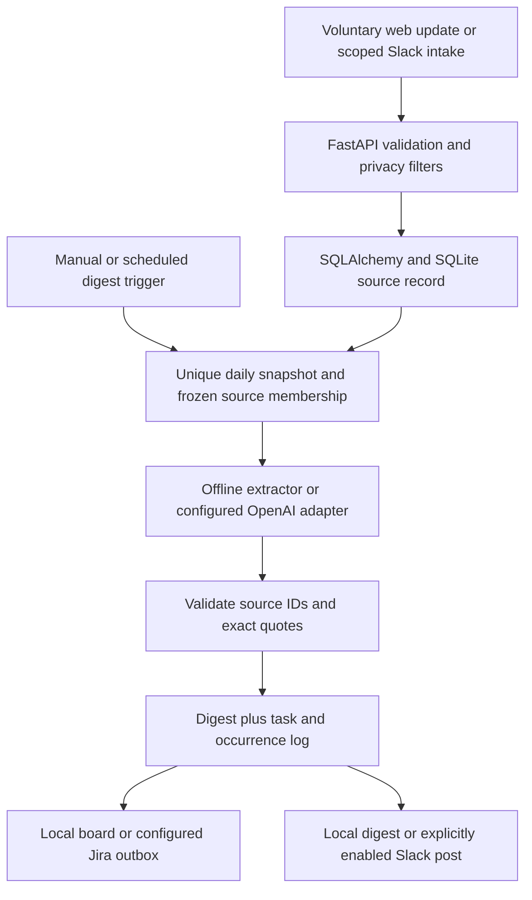

# PulseDesk — Team 182 Hackathon Master Guide

**Microsoft Innovate 2026 · Day 1 · 7 October 2026**  
**Registered problem:** The Status-Update Tax  
**Theme:** Smart Assistants & Chatbots (Enterprise Conversational AI)

> Use this as the team's shared briefing, speaking plan, demo runbook and panel-answer sheet. The attached allocation sheet—not the idea-submission PDF—has your room and panel. Find Team 182 there.

## Read this first: today’s plan

The evaluation is **today, 7 October**. Registration starts at **9:00 AM** near D5 Hostel. Classes stand suspended from **12:30 PM** for participants. All six members should be in the assigned room by **12:45 PM**. Evaluation runs **1:00–4:00 PM**; each team gets **7–10 minutes including questions**. The selected teams are announced by **6:00 PM**. If selected, Day 2 details arrive by **10:00 PM**; keep **8 October** free.

Bring every member’s college ID, the laptop and charger, a repository with its real commit history ready to open, and an offline working copy. Arrive early for registration. Agree on the room, who carries the laptop, and where the backup copy lives before leaving.

The panel awards 25 marks for working demonstration, 15 for demonstration depth, 20 for technical implementation, 15 for problem fit, 15 for product potential/scalability, and 10 for team effort/clarity. The demo is **40 marks**. A persuasive pitch cannot substitute for a feature that fails on screen. A selection result cannot be guaranteed; a reliable demonstration and clear, truthful answers are within the team’s control.

## 1. The product in one minute

### One-line description

**PulseDesk collects voluntary daily updates, creates a source-backed progress/blocker/next-step digest, and turns blockers and stated next steps into traceable tasks.**

### The problem you registered

Distributed teams lose morning time repeating status, chasing updates and manually connecting blockers to work. Updates are scattered; managers must consolidate them; blockers can get buried. PulseDesk addresses this particular problem through async collection, one digest, direct evidence links and tasks. Keep the registered problem and domain. Do not pivot to a generic chatbot or an unrelated productivity product.

### What makes this more than a summary

The product links claims back to the submitted update, stores task evidence, records each distinct report of a repeated finding, and lets a team member set a deadline explicitly. The designed flow goes from voluntary input to an inspectable action, while excluding broad channel surveillance and employee scoring.

### Describe the running build accurately

| Capability | What is true in this evaluation build |
|---|---|
| Web experience | A polished local dashboard served by FastAPI using local HTML, CSS and JavaScript. It does not require a separate frontend server or Node to run. |
| Input | Consent-based web update form works offline. Slack slash-command and event adapters are implemented; live Slack needs setup. |
| Digest | Offline demo uses deterministic, labelled extraction. It is not calling an LLM. An OpenAI structured-output adapter is implemented but needs credentials and a live test. |
| Evidence | Each claim has a source ID and verbatim quote checked against the stored input. A source link is shown when a real link exists. This checks provenance; it does not prove a paraphrase is logically entailed. |
| Tasks | Offline mode writes task records to the local board. The Jira adapter is implemented, including create/update and due-date payload handling; live Jira was not exercised. A local task is not a Jira issue. |
| Repeated finding | Same category plus normalized exact evidence wording reuses one task. Each distinct source update adds one history event. Different phrasing is not guaranteed to merge semantically. |
| Deadline | A team user explicitly sets/edits/clears a date on a task. The extractor does not guess deadlines. In live mode, a change queues Jira synchronization; it is asynchronous and must be verified. |
| Platform | The demo is FastAPI + SQLAlchemy + SQLite and a local browser UI. It is not a Microsoft Teams bot. Do not imply Teams/Azure integration because this is a Microsoft event. |
| User access | Shared team-admin sign-in, signed session cookie, CSRF checks and scoped team/channel data. This edition does not provide per-person SSO or fine-grained roles. |

**If asked about the submission slide saying React + Vite:** “That described our earlier prototype/technical plan. The evaluation package now serves the dashboard directly from FastAPI so the offline demo is simpler. The registered problem and workflow are the same. We’ll show the code that is actually running.” Only say this if it matches the build you have open.

## 2. System flow and data you should understand



### Processing sequence

1. A teammate deliberately submits a short update (or uses an explicitly approved Slack interaction).
2. FastAPI validates input, consent, team/channel scope and source identity. The repository saves the original text and submission metadata.
3. A digest trigger creates or returns the same unique team/channel/day digest. Its cutoff and source membership are frozen.
4. The selected extractor returns typed Progress, Blockers and Action Items with entry IDs and quotes.
5. Evidence validation rejects unknown entry IDs and quotes absent from the exact source. The digest renderer uses stored source IDs/URLs; it does not allow the model to invent a link.
6. Blockers and explicit next steps are written as durable task/outbox records. Task history records a distinct source once. Workers sync safe operations and hold uncertain remote outcomes for review.

### Main code map

| File | What it owns | Person to answer first |
|---|---|---|
| `app/main.py` | FastAPI application factory, static UI serving, security headers, bot/webhook initialization and lifecycle | Akshat |
| `app/api.py` | Login/session, update and digest APIs, sources, task history/deadline APIs | Akshat |
| `app/auth.py` | Signed session, CSRF/origin checks and login controls | Akshat |
| `app/bot_handler.py` | Slack Bolt slash command and optionally approved channel events | Akshat / Prithvi |
| `app/repository.py` | Input persistence, source identity, deduplication and validation | Akshat / Pradyuman |
| `app/llm_service.py` | Typed output schema, deterministic demo extractor, OpenAI adapter, evidence verification | Akanksha |
| `app/digest_service.py` | Daily snapshot, claim-to-source mapping, task identity, occurrence history, posting/sync state | Prithvi |
| `app/worker.py` | Polling, scheduled trigger, lease-based processing | Prithvi |
| `app/tracker_client.py` | Local demo tracker and Jira Cloud adapter | Prithvi |
| `app/models.py` | SQLAlchemy entities, keys, checks and foreign-key scopes | Pradyuman |
| `migrations/versions/product_001_initial_schema.py` | Initial product schema | Pradyuman |
| `migrations/versions/product_002_task_history_deadlines.py` | Existing-data-safe task history and deadline schema change | Pradyuman |
| `app/static/index.html`, `app/static/app.js`, `app/static/styles.css` | Dashboard and task/history/deadline UI | Eva |
| `tests/` | API, privacy, evidence, task, migration-related contract and UI smoke coverage | Everyone in their area |

### Main records and their purpose

| Record | What it stores | Important integrity rule |
|---|---|---|
| `User` | Platform/workspace identity, display name and team scope | Platform identity is unique in its workspace. This is not a performance record. |
| `StandupEntry` | Original submitted text, author/source IDs, source URL if real, timestamp, channel/workspace and local standup day | A platform/workspace/source key makes replayed intake idempotent. |
| `DailyDigest` | Date, timezone/cutoff, status, frozen structured output/text, attempts and publication state | One digest per team/channel/day. A second trigger reuses it. |
| `DigestSource` | Membership of an entry in the frozen digest | Later submissions do not silently rewrite the saved snapshot. |
| `TrackerSync` | Category/text/evidence, stable task key, status, external ticket mapping, due date and sync metadata | Stable task identity supports safe upsert; processing/review records are protected. |
| `TaskOccurrence` | One task/source event with exact quote, digest and original entry association | Unique `(task_id, entry_id)` means the same saved update counts once. Scoped foreign keys bind task, digest and source. |

### Idempotency and duplicate counting — explain precisely

- Replaying the **same input request/source ID** is not a new report.
- Re-triggering the **same frozen team/day digest** returns the same digest rather than creating a second daily summary.
- A **different original submission** that contains the same category and normalized evidence quote can add a task occurrence. Three distinct submissions yield **3 reports · 2 repeats**. The first is the original; two more are repeats.
- A repeated task is merged by category plus normalized evidence wording (case/whitespace normalization), not by broad semantic understanding. “Waiting on staging credentials” and a differently worded version might remain separate tasks.
- The occurrence history holds the author, submission time, digest day, exact quote, stable source ID/URL where available, and record time. It is evidence of repeated reporting of a task, not an employee activity score.

### Deadline behavior — explain precisely

The team sets the task due date; the AI does not infer one. A date is treated through the end of that day in the configured team timezone. The board can show upcoming, due today, overdue, completed or no deadline. Completed tasks are not marked overdue. Setter/time are recorded. Clearing the date is supported. In live mode the app queues `duedate` to Jira; the panel should hear “queued for sync” until Jira acceptance is confirmed.

### Privacy boundary

- Default configuration gathers explicit web submissions and `/standup` interactions; it does not poll Slack channel history.
- Optional Slack message intake must be deliberately enabled for one configured, approved channel. The handler filters workspace/channel, ignores DMs, unrelated channels, bots, edits/deletes and invalid events. Keep event subscriptions off unless needed and invite the app only to that channel.
- The system does not collect DMs, presence, employee attendance, channel history, reaction data or personal productivity rankings.
- The web form requires the user to choose to share. The digest should be visible only to its intended team audience.
- In live AI mode, update text is sent to the configured OpenAI endpoint. The team must disclose this and agree its privacy boundary before enabling it. The offline demonstration does not send it to OpenAI.
- Downstream Jira/Slack audiences matter too. Do not enable live integrations before reviewing who can see the ticket or post.
- Explain limitations honestly: this hackathon edition uses shared admin authentication and does not yet implement full per-user SSO/RBAC or automated retention/erasure across all copies.

## 3. Role review and speaking distribution

The roles below match the Round 1 submission. The demo handoffs split the six voices while leaving the highest-value workflow uninterrupted. Each person should only claim code/work they can personally explain. If the implementation assignment changed, update the spoken ownership now; do not memorize a false contribution story.

| Member | Submitted role | Demo duty | Be ready to explain |
|---|---|---|---|
| **Mishika Shanker** | Team leader | Host, opening, transitions, closing, timekeeper | Problem fit, target user, why async/source links/tasks matter, honest roadmap, direct the right teammate to technical questions |
| **Eva Vashishtha** | Frontend developer | Sole laptop operator; show the complete product flow | What the dashboard shows, consent form, digest, source drawer, report badge/history, explicit deadline, how browser calls FastAPI; current UI files are HTML/CSS/JS served by FastAPI |
| **Akshat Singh** | Backend developer | Explain intake/API/authentication | FastAPI routes, request validation, source ID/idempotency, CSRF/session, Slack signature and scope checks, privacy filters |
| **Prithvi Singh** | Backend developer | Explain digest worker and task/tracker lifecycle | Frozen daily digest, worker leases/retries, task upsert, Jira adapter, why ambiguous remote outcome is held for review |
| **Akanksha Bhatt** | AI developer | Explain extraction and evidence limits | JSON schema, prompt constraints, deterministic offline extractor vs live OpenAI adapter, quote/ID verification and why it is provenance not truth proof |
| **Pradyuman Sorout** | Database manager | Explain source/task/history schema and migration | SQLAlchemy entities, unique keys/foreign keys, occurrence counting, deadline fields, migration keeps task IDs and only backfills retained evidence |

### Stage mechanics

- **Eva operates the laptop for the whole demo.** Prepare the relevant screens/code tabs in advance; avoid six people changing seats or touching the keyboard.
- **Mishika is the only host.** She announces each handoff and watches the clock. Teammates give one-sentence answers unless the judges ask for depth.
- **Akshat answers intake/security/API. Prithvi answers jobs/tracker. Akanksha answers model/evidence. Pradyuman answers storage/history/migrations. Eva answers UI and demo state.** Mishika routes product/impact/team questions and can invite a specialist.
- Keep the live flow first. If there is a delay, remove code exposition before removing the source link or repeated-task proof.
- All six must be present for attendance even if a member has no speaking slot.

## 4. Exact 7–10 minute presentation plan

Plan **5:20 of prepared talk/demo** plus **1:40–4:40 for questions**. This leaves room inside a 7–10 minute slot. Speak at a natural pace; do not race through text. If the panel gives only seven minutes, protect the product flow and shorten each code explanation to one sentence.

| Time | Speaker | What happens |
|---|---|---|
| 0:00–0:35 | Mishika | Opening/problem/registered solution |
| 0:35–3:10 | Eva | Update → digest → source → repeat/history → deadline |
| 3:10–3:45 | Akshat | FastAPI intake, privacy and idempotency |
| 3:45–4:15 | Akanksha | Offline/LLM distinction and evidence check |
| 4:15–4:40 | Pradyuman | SQLite model, uniqueness, occurrence migration |
| 4:40–5:05 | Prithvi | Worker/task outbox/Jira safety |
| 5:05–5:20 | Mishika | Value, next pilot, questions |
| 5:20 onward | Mishika moderates; relevant member answers | Ask one person to answer; avoid overlapping voices |

### Word-for-word script

#### Mishika — opening (about 35 seconds)

> “Good afternoon. We are PulseDesk, Team 182, and our registered problem is The Status-Update Tax. Distributed teams lose time repeating updates, chasing responses, and manually turning blockers into tasks. PulseDesk collects short, voluntary updates and turns them into one source-backed daily digest and traceable tasks. We’ll show a repeated blocker with its original reports and an explicit deadline using synthetic data in our offline demo.”

#### Eva — demonstration (about 2 minutes 35 seconds)

**Start:** Overview already open and signed in; show the Local demo badge. The prepared database contains two synthetic reports with the exact blocker `Waiting on staging credentials.` The digest must not yet exist for today. Keep this sample clearly labeled as synthetic.

**Submit the third update:** Open Share an update and choose Maya. Type a short completion such as “Finished usability notes”; next step “Share the findings with design”; blocker **exactly** `Waiting on staging credentials.` Check the consent box and submit.

Say: “This is a deliberate report. People choose what to share; PulseDesk does not infer status from their activity.”

**Generate digest:** Show progress, blockers and next steps. State: “This is the deterministic offline extractor. I’m not claiming that this demo just called an LLM.”

**Open blocker source:** Click a source link; show original text and stable source ID. Say: “This quote is from the stored update. A real Slack message can carry a permalink; this web form has a stable source ID, so we do not invent a URL.”

**Show repeated task:** Open Task board; find the task whose evidence is the staging-credentials wording. Point to **3 reports · 2 repeats**; open occurrence history and show three separate source entries. Say: “These are three different saved reports of one finding. Retrying the request or digest does not make a fourth report.”

**Set deadline:** Choose Set deadline for this task and enter **8 October 2026**. Say: “A teammate explicitly selected this date. The AI does not guess deadlines, and the date stays attached to this task.”

**Return to digest/finish:** “The team can review the source behind a finding, see whether it recurs and set a clear next deadline. Now we’ll explain how we protect the inputs and keep retries safe.”

**Retry proof:** The published UI does not offer another Generate button after the digest is frozen. Do not search for one. If asked, Akshat can show the API idempotency test/code and explain that the same team/day trigger returns the same digest ID; the report count stays three.

#### Akshat — intake and FastAPI (about 35 seconds)

> “FastAPI validates and stores each voluntary update before returning success. Dashboard routes require a signed session; writes are protected by CSRF checks. Slack requests are signature- and timestamp-verified, then scoped to the configured workspace and standup channel. A stable source identity makes a replay of the same submission safe.”

Be ready to show `app/api.py`, `app/repository.py`, and `app/bot_handler.py` already open. Do not claim the live Slack app was tested if you did not configure it.

#### Akanksha — extractor and evidence (about 30 seconds)

> “The output contract separates progress, blockers and action items. The live adapter requests structured JSON, and before side effects we check that each cited entry exists and each quote appears in that saved update. This prevents unknown sources and made-up quotes, but it does not mathematically prove every paraphrase is entailed. Our current offline demo uses deterministic extraction, not a live model call.”

Show `app/llm_service.py`: the typed `Extraction` schema, `verify`, `DemoExtractor`, and `OpenAIExtractor`.

#### Pradyuman — database and history (about 25 seconds)

> “SQLite is the local database through SQLAlchemy. A unique task/source pair lets each original report appear once in the occurrence log, even when processing is retried. Scoped foreign keys connect the task, digest and source. The new migration preserves existing task IDs and backfills only evidence still present; missing older reports cannot be reconstructed.”

Show `TaskOccurrence` in `app/models.py` and `product_002_task_history_deadlines.py`.

#### Prithvi — worker and tracker (about 25 seconds)

> “A database-backed worker processes frozen digest jobs and the task outbox with leases and bounded retries. Offline mode stores local tasks. The Jira adapter is implemented for create/update, source evidence and explicit due dates, but this environment has not tested a real Jira account. If a remote create times out ambiguously, we hold it for review instead of blindly making a duplicate.”

Show `app/digest_service.py` and `app/tracker_client.py`.

#### Mishika — closing (about 15 seconds)

> “PulseDesk connects voluntary updates to shared clarity and action, with source traceability and an inspectable repeat history. Our next pilot would measure consolidation time, source quality and ticket accuracy before wider rollout. Per-user access controls and retention workflows are future work. We’re ready to show the code or answer your questions.”

## 5. Demo preparation runbook

### Build a fresh rehearsal database

Never delete the only database to reset the demo. Use a separate filename for the judging rehearsal so the prepared digest is not frozen by an earlier run.

1. Apply the patch to a copy of the complete product, then install Python dependencies while internet is available. Keep the actual evaluation environment in `MODE=demo`.
2. In the project root, copy `.env.example` to `.env`; edit these values and leave the rest as demo defaults:

   ```dotenv
   MODE=demo
   DATABASE_URL=sqlite:///./data/team182_rehearsal.db
   DIGEST_HOUR=23
   DIGEST_MINUTE=59
   SEED_DEMO=true
   ```

3. In that same terminal/environment run:

   ```bash
   python prepare_judging_demo.py
   python run.py
   ```

4. Open `http://127.0.0.1:8000`; sign in using the demo credentials you configured (defaults: `admin` / `demo-pulsedesk`). Check the Local demo badge.
5. The helper prepares two made-up reports and does not create the digest. During the presentation, Maya submits the third exact blocker; then generate today’s digest. Confirm the board shows 3 reports and 2 repeats before using this database in front of judges.
6. Rehearse the deadline edit and source drawer. Do a separate test database if you need another full live run: the digest is intentionally frozen per day.

### Windows quick commands

In PowerShell, after downloading/extracting the full product and patch as in the local-hosting instructions:

```powershell
Set-Location C:\PulseDesk\PulseDesk
py -3.11 -m venv .venv
.\.venv\Scripts\Activate.ps1
python -m pip install -r requirements.lock
Copy-Item .env.example .env
notepad .env
python prepare_judging_demo.py
python run.py
```

Set `DATABASE_URL=sqlite:///./data/team182_rehearsal.db` and schedule hour/minute to `23`/`59` before the helper/run steps. The helper creates `data/` and applies migrations; `run.py` also applies migrations on startup. Open `http://127.0.0.1:8000`. Use `python run.py --port 8001` if port 8000 is busy. `Ctrl+C` stops the app. The UI is served by FastAPI; no npm or separate frontend server is needed.

### Two-minute pre-slot check

- App starts and Overview loads; password works; Local demo badge is visible.
- Date is 7 October 2026 in the demo team timezone; there is no frozen digest for today.
- Two synthetic source reports exist; the third submission uses the **exact same blocker wording**.
- No terminal errors; browser zoom/layout is readable on the projector; notifications are silenced.
- Task board has one matching task with three occurrences; history opens; original source opens; deadline can be saved.
- Code editor tabs are pre-opened at the route, verifier, model, migration and worker/tracker locations.
- `.env` and tokens are not on screen; do not `git add` `.env`, DB, venv or node_modules.
- All six members and IDs are present. Room/panel confirmed from allocation sheet.
- Backup DB, repository clone and short recording are on disk. If used, identify a recording as a backup rather than calling it a live run.

### If a step fails

1. Do not spend more than about 30 seconds repeatedly clicking. Eva pauses input; Mishika narrates the actual state.
2. Restart `python run.py`; confirm the database URL and port. The launcher applies migrations automatically. Preserve the database.
3. If today’s digest was already generated, it is frozen by design. Do not delete data at the table; use the prepared screenshot/recording and explain the idempotency behavior in code/tests.
4. If an external service is unavailable, show the local demo and say it is local. Do not call a local task Jira or say the offline extractor is AI.
5. If live demonstration cannot recover, label the backup as a recording, then show the real code path and test results. Be honest about what the panel saw.

## 6. How to earn evidence for every scoring category

| Marks | Panel is looking for | Your visible evidence |
|---:|---|---|
| **25 Working demonstration** | Product starts and a real flow works | Submit an update, generate the digest, show tasks, set/persist deadline |
| **15 Demonstration depth** | You understand what the UI represents | Open exact source, show 3-event occurrence log, explain retry count and frozen daily snapshot |
| **20 Technical implementation** | Sound design beyond screens | FastAPI routes/auth, evidence verification, unique keys, scoped foreign keys, migration, worker leases/outbox, test suite |
| **15 Problem fit** | Registered challenge is solved | Async input → consolidated progress/blockers/next steps → traceable tasks, privacy boundary |
| **15 Product potential/scalability** | Plausible path beyond prototype | Slack/Jira adapters, PostgreSQL-compatible models, independent worker, bounded pilot and evaluation plan; label as roadmap where not tested |
| **10 Team effort/clarity** | Whole team understands and contributed | All six attend; split explanation by real ownership; repository history is authentic; clear answers without contradiction |

Do not invent savings, customer demand, usage, deployment, speed-up, semantic accuracy or provider tests. If there is no measurement, say “expected benefit” and describe how a pilot would measure it. Do not spend presentation time on a long market-size slide; show the product working.

## 7. Likely panel questions and concise answers

Answer directly in 15–30 seconds. If you don’t know, say what you know, what is not implemented/tested, and the next test. No one should guess a teammate’s implementation detail.

### Product and problem

**What is the Status-Update Tax?**  
Time and attention spent repeating status, chasing replies and manually consolidating blockers into action. PulseDesk tries to reduce that work with short async updates and one traceable digest.

**Who is the user?**  
Distributed team members submit their own updates; a team lead reviews the shared digest and resulting work. The hackathon build is a single-team product, not a multi-tenant enterprise rollout.

**What makes it different from a generic summarizer?**  
The claim-to-source evidence, actionable task records, repeat history and explicit deadline workflow. We can inspect why a blocker appeared and how often distinct updates reported it.

**How do you know it saves time?**  
We have not run a user study and do not have a measured percentage. A pilot would compare time spent compiling updates and following blockers before and after, while asking members whether the process feels useful and safe.

### AI, accuracy and repeats

**Is an LLM running right now?**  
No. This offline demo uses deterministic labelled extraction. The OpenAI structured-output adapter is implemented; it needs credentials, disclosure and live validation. We won’t present a rule-based output as an LLM call.

**Can the model make up a blocker?**  
The system rejects unknown entry IDs and quotes not found in the original stored update. That checks source provenance, not whether every paraphrase is semantically entailed. Quality evaluation and human review remain important.

**Why exact quote instead of semantic duplicates?**  
Conservative matching reduces the risk of joining two unrelated problems. This edition merges normalized same wording; semantic matching is future work and needs evaluation before use.

**What does 3 reports · 2 repeats mean?**  
Three different original update IDs report the same task wording. The first is the original report and the next two are repeats. Replaying an HTTP request or digest does not increase the count.

**What if one digest contains the same claim twice?**  
The `(task, source entry)` uniqueness rule keeps one occurrence per original source on that task. A different source can create a distinct occurrence.

**Can you recover old repeats from before this patch?**  
Only if the previous task payload still contains the supporting evidence. The migration backfills that available evidence and preserves task IDs; it cannot recreate history that was discarded.

### Privacy, security and consent

**Are you monitoring employees?**  
No. We process deliberate updates or—only if enabled—messages in an approved standup channel. We do not ingest DMs, general channel history, presence or individual performance scores. The repeat count belongs to a task, not a person’s productivity rating.

**How do you prevent Slack from reading all channels?**  
Events are off by default. If channel message intake is enabled, the bot is invited only to the chosen channel and the handler checks workspace/channel and message type. We do not call the history API to scrape past messages. The simplest demo path is explicit web submissions.

**Where does the input go in live AI mode?**  
It is sent to the configured OpenAI endpoint as part of the extraction request. That requires disclosure and approval before enabling the integration. Today’s offline demo does not send it externally.

**Who can see the digest or Jira issue?**  
In this local build, signed-in dashboard users in the configured team can access the dashboard. A live deployment must check Slack destination and Jira project audiences before enabling them. Per-user SSO/RBAC is not in this edition.

**How long is information retained?**  
This edition persists entries, snapshots, evidence and task state in its configured database. Automated retention/erasure across database, Jira, Slack and backups is not fully implemented; define and test it before a real employee pilot.

### Backend, retries, deadline and scale

**What happens if the cron/trigger runs twice?**  
The unique team/channel/day digest key returns the saved snapshot, and frozen source membership prevents the same day changing silently. Worker leases protect concurrent processing. We do not claim exactly-once behavior from remote provider APIs.

**What happens if Jira times out after creating an issue?**  
If the outcome is uncertain, the sync moves to review instead of blindly creating another issue. An operator must inspect the provider before resolving it. Safe retry behavior and remote exactly-once delivery are different guarantees.

**Where does the deadline come from?**  
A signed-in team member explicitly enters a calendar date. We preserve who changed it and when. It is not guessed by the model. In live mode the due-date update is queued and must be verified in Jira.

**Why SQLite? Can it scale?**  
SQLite is practical for the local demo and allows a simple offline run. SQLAlchemy models and migrations are designed for PostgreSQL migration. A production deployment would use PostgreSQL, separate API/worker processes, monitoring, access controls and load/concurrency testing. We are not claiming that load test has happened.

**Why hold ambiguous Jira operations?**  
A lost response does not tell us whether the provider created an issue. Retrying blindly risks duplicates. We favor a visible review state until the remote result is checked.

### Stack and project state

**Why FastAPI?**  
It serves the UI and typed API in one Python service, validates request schemas, exposes OpenAPI documentation and integrates with the async Slack/worker code. SQLite keeps the demo self-contained.

**Is this a Microsoft Teams bot?**  
Not in the current build. It is a FastAPI web experience with Slack adapters. Teams is a possible future adapter, not a capability we will claim today.

**What is actually production-ready?**  
This is a hackathon-ready local product and a pilot foundation, not a certified enterprise deployment. Shared admin access, retention/erasure, per-user controls, real provider verification, production load/security review and automated reconciliation need further work.

**What did each person implement?**  
Each teammate should answer only for their own actual work and show the corresponding commit/code. Use the submitted roles and speaking map in this guide as the planned distribution; do not claim ownership that isn’t true.

## 8. Technical walkthrough if judges request code

Show one short path through code, not a file tour:

1. **Input and privacy:** `app/api.py` update route → `app/repository.py` source identity/persistence; for Slack, `app/bot_handler.py` verification and scope filter.
2. **Stored source:** `StandupEntry` in `app/models.py`; explain source ID versus real permalink.
3. **Structured extraction:** `app/llm_service.py` `Extraction` schema and configured extractor.
4. **Evidence check:** `verify()` requires an allowed source ID and a quote present in the original text.
5. **Daily job/tasks:** `app/digest_service.py` frozen snapshot/task upsert; `app/worker.py` lease and retry behavior.
6. **Repeat history/deadline:** `TaskOccurrence` and `TrackerSync` in `app/models.py`; route/history/deadline in `app/api.py`; migration `product_002`.
7. **External adapter:** `app/tracker_client.py`; Jira due date is `duedate`; actual live call is untested here.

The most important distinctions:

- **Source ID** is a stable internal/platform reference. **Source URL** exists only if supplied by the real platform. Never fabricate a message permalink.
- **Provenance validation** is not a guarantee of semantic truth.
- **Digest idempotency** is not remote API exactly-once delivery.
- **Task repeat count** is distinct original submissions, not retry count or person score.
- **Deadline** is explicit human input, not AI inference.
- **Local task** is not an external Jira issue.

## 9. Final team agreement

Before entering, each person should be able to answer these five questions in one sentence:

1. What problem does PulseDesk solve?
2. What exact screen or code do I own in the presentation?
3. What is working offline today?
4. What important capability is implemented but not live-tested?
5. What will I say if my part fails or a judge asks about a limitation?

**Shared rule:** be calm, specific and honest. Never contradict the visible demo. Let one teammate answer at a time. If a limitation comes up, state it plainly and give the next validation step. Close with the functioning product and the registered problem—not an unsupported promise to “win anyhow.”

### One-minute checklist for Mishika

- [ ] Team 182 room/panel from allocation sheet
- [ ] Six members + college IDs
- [ ] Laptop, charger, offline app and backup
- [ ] Digest not already frozen for demo day
- [ ] `Waiting on staging credentials.` typed exactly for third report
- [ ] Source drawer, `3 reports · 2 repeats`, history, deadline rehearsed
- [ ] Honest statement: deterministic offline demo; live OpenAI/Jira/Slack not tested
- [ ] Five-minute-twenty talk; leave time for judge questions
- [ ] Real repository and commit history open; `.env` hidden
- [ ] 8 October kept free if selected
